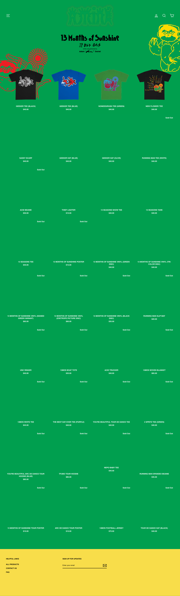

# Amine.Store Design System Analysis

**Source:** https://amine.store/
**Captured:** February 2026
**Purpose:** Design reference for bold, vibrant color blocking and minimalist e-commerce aesthetics

---

## Overview

Aminé's official merchandise store features an exceptionally bold visual identity characterized by:
- **Full-viewport color blocking** with vibrant, saturated hues
- **Zero-border-radius** design philosophy (sharp corners throughout)
- **Minimalist product presentation** without shadows or gradients
- **High-contrast typography** with heavy font weights
- **Simple, clean grid layouts** that let the colors dominate

This design represents a confident, artist-driven aesthetic that breaks from conventional e-commerce patterns.

---

## Color Palette

### Primary Colors

```
█ #009f4f - Vibrant Green (Main Background)
  RGB: (0, 159, 79)
  Usage: Hero section background, primary brand color
  Saturation: High, creates energetic feel
```

```
█ #f8dd4a - Golden Yellow (Footer & Accents)
  RGB: (248, 221, 74)
  Usage: Footer background, highlight elements
  Pairs with: Green for high-energy contrast
```

### Neutrals

```
█ #ffffff - Pure White
  Usage: Primary text on dark backgrounds, clean spacing
```

```
█ #000000 - Pure Black
  Usage: Text on light backgrounds, strong contrast
```

```
█ #111111 - Dark Charcoal
  RGB: (17, 17, 17)
  Usage: Near-black for subtle depth variation
```

### Color Strategy

- **Bold blocking over gradients:** Each section uses solid, saturated colors
- **High saturation:** No muted tones—every color is at full intensity
- **Contrast-driven:** White/black text alternates based on background luminance
- **Color as structure:** Color changes define section boundaries

### Comparison to Fidel Color Scheme

| Aspect | Amine.Store | Fidel (Ethiopian) |
|--------|-------------|-------------------|
| **Green** | `#009f4f` (saturated, modern) | `#00722C` (deeper, traditional) |
| **Yellow** | `#f8dd4a` (golden, bright) | `#FFD500` (pure, iconic) |
| **Red** | Not used | `#CF1D28` (Ethiopian flag) |
| **Approach** | Bold, modern, artist-driven | Cultural, symbolic, heritage |

---

## Typography

### Font Stack

**Primary:**
```css
font-family: Helvetica, Arial, sans-serif
```
- Standard system fonts for maximum compatibility
- Clean, neutral, lets color be the hero

**Custom Font:**
```css
font-family: GTStandard-M
```
- Custom typeface for brand identity
- Used selectively for headings/special elements

### Type Scale & Hierarchy

**Heading 1 (H1):**
```css
font-size: 30px
font-weight: 700 (bold)
line-height: 30px
text-transform: uppercase
```
- Tight line-height (1:1 ratio)
- Heavy weight for maximum impact
- All-caps for commanding presence

**Body Text:**
```css
font-size: 14px
font-weight: 700 (bold)
line-height: 19.6px
```
- Surprisingly bold weight (700) for body copy
- 1.4 line-height ratio for readability
- Creates cohesive "heavy" typographic feel

**Link Text:**
```css
font-size: 14px
text-decoration: underline
color: inherit
```
- Underline for clarity (accessibility-first)
- Inherits parent color (adapts to background)

### Typography Principles

1. **Heavy weights dominate:** Most text is bold (700), creating visual confidence
2. **Tight spacing:** Line-heights are compact, reinforcing density
3. **Simple hierarchy:** Limited scale (14px → 30px), clarity over complexity
4. **Underlines over hover states:** Direct, accessible link styling

---

## Layout Patterns

### Grid System

**Product Grid:**
```
Desktop: 3 columns
Mobile:  2 columns (responsive breakpoint around 768px)
```

**Grid Properties:**
```css
gap: 20px (estimated)
padding: 20px container edge
margin: auto-centered
```

### Product Card Structure

**Minimalist Approach:**
- **Image:** Full-width, no border, no shadow
- **Title:** Bold text below image
- **Price:** Secondary text, same weight as title
- **No hover effects:** Static presentation (confidence in simplicity)
- **Sharp corners:** 0px border-radius throughout

**Card Spacing:**
```
Image aspect ratio: ~1:1 (square products)
Text padding: 10-15px
Inter-card gap: 20px
```

### Section Layout

**Full-Viewport Color Blocks:**
```
Header:  White background, minimal
Hero:    Green (#009f4f), full-screen
Content: White background, grid
Footer:  Yellow (#f8dd4a), links
```

Each section spans 100vw (full viewport width) and uses color to delineate boundaries.

### Spacing System

**Estimated Scale:**
```
xs:  5px   - Tight inline elements
sm:  10px  - Within cards
md:  20px  - Between cards, sections
lg:  40px  - Major section padding
xl:  80px  - Hero spacing
```

---

## Design Principles

### 1. Bold Color Blocking
- Each section is a solid color field
- No gradients, no subtle transitions
- Color = visual structure

### 2. Zero Border Radius
- All elements: `border-radius: 0`
- Creates sharp, modern, gallery-like aesthetic
- Contrasts with rounded "friendly" design trends

### 3. Minimalist Product Cards
- No shadows (`box-shadow: none`)
- No borders (`border: none`)
- Just image + text, maximum clarity

### 4. High Contrast Typography
- Pure white on dark backgrounds
- Pure black on light backgrounds
- Bold weights (700) for legibility at any size

### 5. Simplicity Over Complexity
- Limited interactive elements (underlines, not hovers)
- Straightforward navigation
- Let the music/brand speak through color and product

### 6. Artist-Driven Confidence
- No need for conventional e-commerce patterns
- Bold choices reflect creative brand identity
- Visual language matches music: vibrant, energetic, unapologetic

---

## Key Takeaways for Implementation

### When to Apply This Style

**Good fit:**
- Artist/creative portfolios
- Bold brand identities
- Youth-focused products
- Music/entertainment merch
- Projects needing energetic, modern feel

**Poor fit:**
- Enterprise/corporate applications
- Information-dense interfaces
- Accessibility-critical contexts (heavy bold text can reduce readability for some users)
- Multi-brand platforms (style is very opinionated)

### Adaptation Strategies

**If using for Fidel:**
- Keep Ethiopian color palette (`#00722C`, `#FFD500`, `#CF1D28`)
- Adopt full-viewport color blocking for lesson stages
- Use sharp corners for modern feel while honoring tradition
- Apply bold typography to Amharic script (requires testing for legibility)
- Simplify flashcard UI: no shadows, clean color fields

**If using for other projects:**
- Start with 2-3 vibrant colors (not neutrals)
- Set `border-radius: 0` globally
- Use `font-weight: 700` as default body weight
- Design sections as color blocks, not white boxes
- Test contrast ratios for accessibility (bold colors = careful text choices)

---

## Visual Reference



**Screenshot includes:**
- Full homepage scroll
- Product grid layout
- Color blocking examples
- Typography hierarchy
- Navigation structure

---

## Notes & Observations

- **Animation:** Minimal—no parallax, no complex transitions (reinforces simplicity)
- **Imagery:** Product photos are clean, on white backgrounds (consistent with card style)
- **Accessibility:** High contrast text meets WCAG AA, but bold-everywhere may challenge dyslexic users
- **Performance:** Lightweight—no heavy frameworks visible, fast load
- **Mobile:** Responsive grid, same bold aesthetic maintained at all sizes

**Last Updated:** February 8, 2026
